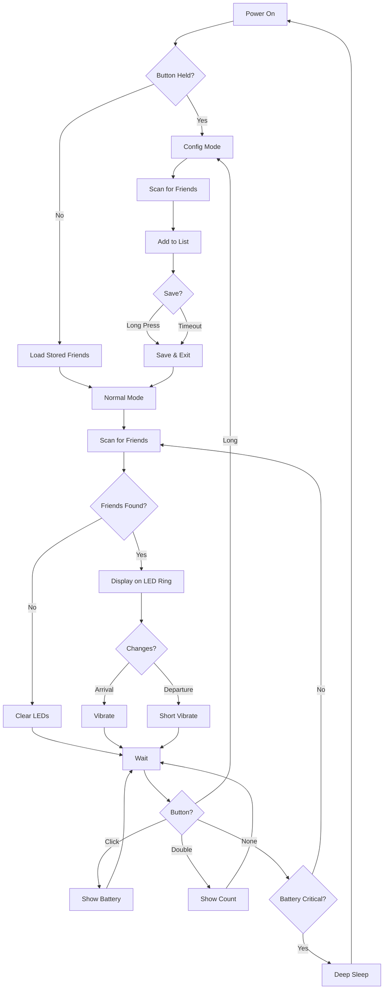

# FriendBeacon v2.0

A sophisticated light beacon for friends that detects nearby FriendBeacon devices via Bluetooth Low Energy (BLE) and displays their presence on an RGB LED ring with visual feedback based on proximity.

## Overview

FriendBeacon is a wearable/portable device that helps you know when your friends are nearby. Each device broadcasts its presence via BLE, and when friends with FriendBeacon devices come within range, your device lights up with unique colors for each friend. The brightness indicates how close they are!

## Features

### Core Features
- **RGB LED Ring Display**: 16 individually addressable LEDs show friend presence
- **Proximity Detection**: RSSI-based distance estimation (bright=close, dim=far)
- **Unique Friend Colors**: Each friend gets their own color on the ring
- **Visual Feedback**: Different animations for various states and events

### Power Management
- **Battery Monitoring**: Real-time voltage and percentage monitoring
- **Low Battery Warning**: Visual and haptic alerts when battery is low
- **Deep Sleep Mode**: Dramatically extends battery life when inactive
- **Adaptive Scanning**: Faster scans when friends are nearby, slower when alone
- **Critical Battery Protection**: Auto-sleep prevents battery damage

### User Interface
- **Smart Button Controls**:
  - **Single Click**: Show battery level
  - **Double Click**: Show friend count
  - **Long Press (3s)**: Enter/Exit configuration mode
  - **Hold During Boot**: Force configuration mode
- **Haptic Feedback**: Vibration motor provides tactile notifications
- **Onboard LED**: Status indicator

### Advanced Features
- **Dynamic Friend Management**: Support for up to 50 friends
- **Configurable MAC Filtering**: Filter devices by MAC address prefix
- **Event Logging**: Track up to 100 events in memory
- **OTA Updates**: Update firmware wirelessly
- **BLE App Integration**: Connect via smartphone app for advanced configuration
- **Adaptive Behavior**: Changes scan frequency based on activity

## Hardware Requirements

### Parts List
- **ESP32-C3 Mini** - Main microcontroller with BLE
- **WS2812B RGB LED Ring** - 16 LEDs (or 12/24 LED variants)
- **3.7V 500mAh LiPo Battery** - Power source
- **3.7V LiPo Battery Charger** - TP4056 or similar
- **Induction Button** - Touch-sensitive or tactile button
- **Vibration Motor** (Optional) - Haptic feedback
- **Voltage Divider** - For battery monitoring (2x resistors)
- **3D Printed Parts**:
  - Case
  - Diffuser

### Pin Configuration (Config.h)
```cpp
ONBOARD_LED: Pin 8      // Status LED
BUTTON_PIN: Pin 10      // Button input
LED_RING_PIN: Pin 7     // WS2812B data line
BATTERY_ADC_PIN: Pin 0  // Battery voltage monitor
VIBRATION_PIN: Pin 9    // Vibration motor PWM
```

### Wiring Diagram
```
ESP32-C3 Pin 7  ──→  LED Ring Data In
ESP32-C3 Pin 9  ──→  Vibration Motor (via transistor)
ESP32-C3 Pin 10 ──→  Button (pull-down)
ESP32-C3 Pin 0  ──→  Battery+ (via voltage divider)
ESP32-C3 GND    ──→  Common Ground
ESP32-C3 3V3    ──→  LED Ring Power (if <500mA)
Battery +       ──→  Power Switch → ESP32 5V/BAT
```

**Note**: Voltage divider for battery monitoring should divide by 2 (adjust `VOLTAGE_DIVIDER_RATIO` in Config.h).

## Software Architecture

The firmware is organized into modular components:

### Core Classes
- **Config.h**: Central configuration and compile-time settings
- **LEDRing.h**: RGB LED control, animations, and patterns
- **BatteryMonitor.h**: Battery voltage monitoring and management
- **VibrationMotor.h**: Haptic feedback patterns
- **ButtonHandler.h**: Debounced button input with multi-press detection
- **FriendManager.h**: Friend list management and persistence
- **EventLogger.h**: Event logging and debugging
- **PowerManager.h**: Deep sleep and power optimization
- **BLEManager.h**: BLE scanning and app integration
- **OTAUpdate.h**: Over-the-air firmware updates

## Usage

### First Time Setup
1. Power on the device
2. Hold the button during boot to enter **Config Mode**
3. LED ring displays rainbow animation
4. Device scans for nearby FriendBeacon devices (MAC prefix: `dc:06:75` by default)
5. Each detected friend causes a pulse vibration
6. LED count shows number of friends found
7. Hold button for 3 seconds to save and exit
8. Configuration auto-saves after 60 seconds

### Normal Operation
1. Device automatically scans for friends every 6 seconds
2. When friends are detected:
   - LED ring lights up with unique color per friend
   - Brightness indicates distance (RSSI)
   - Vibration pulse on friend arrival
   - Quick vibration on friend departure
3. Scan interval reduces to 3 seconds when friends are present
4. Battery checked every 30 seconds

### Button Functions
| Action | Result |
|--------|--------|
| Single Click | Show battery level (2 seconds) |
| Double Click | Show friend count (1.5 seconds) |
| Long Press (3s) | Enter/Exit config mode |
| Hold During Boot | Force config mode |

### LED Patterns
| Pattern | Meaning |
|---------|---------|
| Rainbow | Configuration mode |
| Static colors | Friends present (color per friend) |
| Bright | Friend is close (RSSI > -60 dBm) |
| Medium | Friend is medium distance (RSSI > -75 dBm) |
| Dim | Friend is far (RSSI > -90 dBm) |
| Red flash | Low battery warning |
| Green flash | Configuration saved |
| Spinner | Booting/initializing |

### Vibration Patterns
| Pattern | Event |
|---------|-------|
| Single pulse | Friend detected |
| Quick pulse | Friend left |
| Double pulse | Entering config mode |
| Long vibration | Config saved |
| Error pattern | Critical error |

## Configuration

### Adjustable Parameters (Config.h)
```cpp
// LED Configuration
#define NUM_LEDS 16              // Number of LEDs in ring
#define LED_BRIGHTNESS 128       // Default brightness (0-255)

// Battery Thresholds
#define BATTERY_MAX_VOLTAGE 4.2  // Fully charged
#define BATTERY_MIN_VOLTAGE 3.3  // Minimum safe
#define BATTERY_WARNING_VOLTAGE 3.5

// Power Management
#define SLEEP_DURATION_US 30000000    // 30 seconds
#define SLEEP_AFTER_NO_FRIENDS_MS 300000  // 5 minutes

// Friend Management
#define MAX_FRIENDS 50           // Maximum friends to track

// RSSI Thresholds
#define RSSI_NEAR -60           // Close proximity
#define RSSI_MEDIUM -75         // Medium distance
#define RSSI_FAR -90           // Far distance

// Debug Level
#define DEBUG_LEVEL 2           // 0=OFF, 1=ERROR, 2=INFO, 3=DEBUG
```

## BLE App Integration

The device exposes BLE GATT services for smartphone integration:

### Service UUID
`4fafc201-1fb5-459e-8fcc-c5c9c331914b`

### Characteristics
| Characteristic | UUID | Type | Description |
|---------------|------|------|-------------|
| Battery | `beb5483e-36e1-...` | Read/Notify | Voltage and percentage |
| Friends | `1c95d5e3-d8f7-...` | Read/Notify | Friend list with status |
| Config | `9a8ca5cf-3f4b-...` | Read/Write | Configuration settings |
| Command | `7d3f8e2a-5c6b-...` | Write | Remote commands |

### Data Formats
- **Battery**: `"4.15,92.5"` (voltage, percentage)
- **Friends**: `"aa:bb:cc,1,-65;dd:ee:ff,0,-100"` (mac,present,rssi)

## OTA Updates

### Via Arduino IDE
1. Connect to same WiFi network as FriendBeacon
2. Device hostname: `FriendBeacon-XXXXXX` (last 6 chars of MAC)
3. Default password: `friendbeacon`
4. Select network port in Arduino IDE
5. Upload sketch normally

### Via PlatformIO
```bash
pio run -t upload --upload-port FriendBeacon-XXXXXX.local
```

## Flow Diagram



## Troubleshooting

### LEDs Not Working
- Check LED_RING_PIN in Config.h matches your wiring
- Verify power supply can provide enough current (16 LEDs × 60mA = ~1A max)
- Ensure LED data line is connected to correct pin
- Try reducing LED_BRIGHTNESS

### Friends Not Detected
- Verify MAC prefix filter matches your devices (default: `dc:06:75`)
- Check both devices are powered on and advertising
- Ensure devices are within BLE range (~10-50 meters depending on environment)
- Try entering config mode to rescan

### Battery Reading Incorrect
- Adjust VOLTAGE_DIVIDER_RATIO in Config.h
- Verify voltage divider resistor values
- Check ADC pin connection
- Calibrate against multimeter reading

### Device Not Responding
- Check serial output for error messages
- Verify all required libraries are installed (FastLED, ArduinoOTA)
- Try uploading with DEBUG_LEVEL 3 for verbose output
- Press reset button to restart

### OTA Update Fails
- Ensure device and computer are on same network
- Check OTA_PASSWORD matches in Config.h
- Verify device hostname appears in Arduino IDE
- Try wired upload if wireless fails

## Dependencies

### Required Libraries
- **FastLED** (>= 3.6.0) - RGB LED control
- **ArduinoOTA** (>= 1.0.0) - Over-the-air updates
- **Preferences** (ESP32 built-in) - Non-volatile storage
- **BLEDevice** (ESP32 built-in) - Bluetooth Low Energy

### Install via Arduino IDE
```
Sketch → Include Library → Manage Libraries
Search: FastLED, ArduinoOTA
Install both libraries
```

### Install via PlatformIO
```ini
lib_deps =
    fastled/FastLED@^3.6.0
    ArduinoOTA
```

## Advanced Customization

### Adding Custom MAC Prefixes
Edit Config.h:
```cpp
#define DEFAULT_MAC_PREFIX "dc:06:75"  // Change to your device prefix
```

Or add multiple prefixes programmatically via FriendManager.

### Custom LED Patterns
Modify LEDRing.h to add new animations:
```cpp
void myCustomPattern() {
  // Your animation code
}
```

### Adjusting Power Consumption
- Reduce LED_BRIGHTNESS
- Increase FRIEND_SCAN_INTERVAL_MS
- Enable DEEP_SLEEP_ENABLED
- Lower BLE_SCAN_TIME

### Battery Life Optimization
Expected battery life with 500mAh battery:
- **Without sleep**: ~6-10 hours
- **With light sleep**: ~24-48 hours
- **With deep sleep**: ~1-2 weeks (checking every 30s)

## Development

### Building
```bash
# Arduino IDE: Open .ino file and upload
# PlatformIO:
cd Arduino/FriendBeacon
pio run --target upload
```

### Debug Output
Set DEBUG_LEVEL in Config.h:
- 0: No output
- 1: Errors only
- 2: Info + Errors (default)
- 3: Full debug output

### Serial Monitor
```
Baud rate: 115200
```

## License

This project is open source. See LICENSE file for details.

## Contributing

Contributions welcome! Please:
1. Fork the repository
2. Create a feature branch
3. Make your changes
4. Submit a pull request

## Version History

### v2.0.0 (Current)
- Complete rewrite with modular architecture
- Added RGB LED ring support with proximity-based intensity
- Implemented battery monitoring and management
- Added vibration motor support
- Deep sleep power optimization
- Improved button handling (click, double-click, long press)
- RSSI-based proximity detection
- Increased friend capacity to 50
- Added configurable MAC filtering
- Event logging system
- OTA update support
- BLE app integration
- Comprehensive error handling

### v1.0.0 (Original)
- Basic BLE friend detection
- Simple LED indicator
- Manual configuration mode
- Limited to 10 friends

## Credits

- Original concept and hardware design
- Enhanced firmware by Claude (Anthropic)

## Support

For issues, questions, or contributions, please open an issue on GitHub.

---

**Made with ❤️ for bringing friends together**
